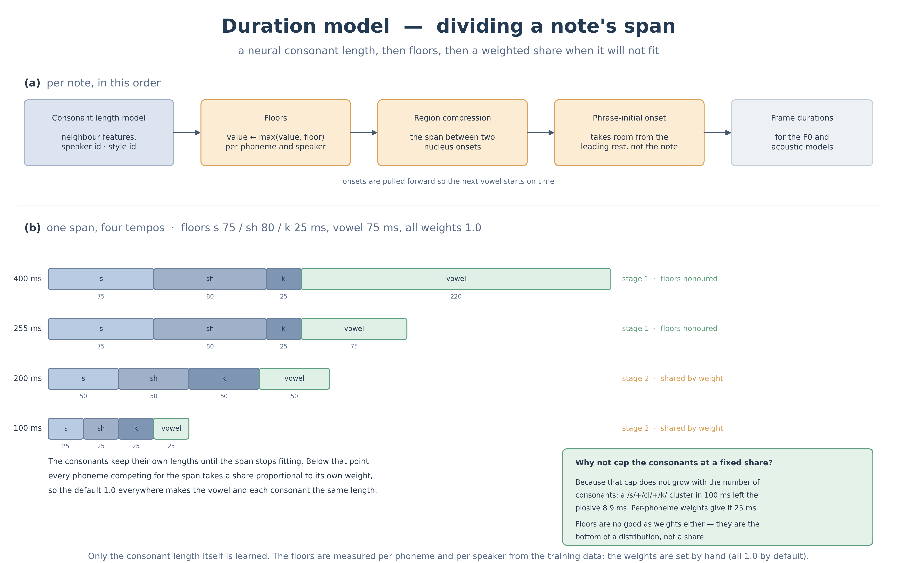

# 持続長モデルと後処理のしくみ



`duration_model/`（学習と推論）と `svs/duration_postprocess.py`（後処理）の挙動をまとめた資料です。両者は分かちがたく、片方だけ読んでも動作を追えないため、ひとつの文書にしています。

---

## 1. このモデルが行うこと

**決めるのは子音の長さだけです。** 母音の長さは、ノート長から子音の取り分を引いた残りです。

```
['k','a'] と ['t','a'] 0.5 秒のノートが並ぶとき
  pau:250  k:60  a:466.3  t:33.7  a:500  pau:250
                  └ 500 − 33.7。次のノートの t に削られた残り
```

**母音を削るのは「次のノートの onset」か「自分のノートの coda」です。自分の onset ではありません。** `k` の 60ms は、そのノートの母音からではなく、**ひとつ前の母音**から取られます。フレーズ先頭には削れる母音が無いので、代わりに先頭 pau と場所を取り合います（音素の並びは `[先頭 pau][先頭 onset][核 …]` で、onset は pau の**後ろ**です。§6-④、§8）。

coda を足すと自分の母音が減ります。日本語の `cl`（促音）を coda に置いた例です。

```
['k','a','cl'] 0.5 秒 → pau:250  k:60  a:321.0  cl:136.0  t:42.9  a:500  pau:250
                                       └ coda cl のぶん母音が 466.3 → 321.0 へ
```

**楽譜は学習に要りません（score-free）。** 学習データは wav と音素ラベル（lab）のみです。入力する音高は F0 の代表値から取ります。

---

## 2. モデル本体

`ConsonantDurModel`（`model.py`）は小さな MLP です。

| 構成 | パラメータ数 |
|---|---|
| 日本語 50 音素・話者 3・スタイル 3・`cluster_len` なし（同梱ウェイト） | **27,137** |
| 同上に `cluster_len` を足した場合 | 27,713 |
| 英語 46 音素・話者 1・`cluster_len` あり | 26,561 |

### 入力

`encode()` が実際に読むキーは次のとおりです。

| 特徴 | 型 | 意味 |
|---|---|---|
| `cons_id` | 埋め込み | 対象の子音 |
| `prev_ph_id` / `next_ph_id` | 埋め込み | 直前・直後の音素。子音と母音を区別せず同じ音素空間で扱う |
| `prev_note_dur` / `next_note_dur` | 線形射影 | 前後の音節に与えられた総時間。`log1p(秒 ÷ 0.3)` を通してから射影します |
| `pitch_midi` | 埋め込み | 直後の音節の音高（MIDI） |
| `pitch_diff` | 線形射影 | 直前の音節からの音高差。±12 半音でクランプして 12 で割ります |
| `prev_note_exists` | 埋め込み | 直前に音節があるか |
| `cluster_len` | 埋め込み | 自分が属する子音のクラスターの長さ（§3） |
| `spk_id` / `style_id` | 埋め込み | 話者・スタイル（設定したときのみ） |
| `style_mix` | 混合比 | スタイル埋め込みの加重和。`style_id` の代わりに渡すとスタイルを連続的に混ぜられます |
| `prev2_ph_id` / `next2_ph_id` | 埋め込み | **既定では使いません。** `--wide_context` を付けたときだけ |

すべて hidden 次元に埋め込んで加算します（concat ではありません）。

### 出力

`log(長さ + 0.001)` を回帰し、推論は `exp(出力) - 0.001`、下限 0.005 秒でクランプします。

---

## 3. cluster_len とは何か

**音節核の片側に連続して並ぶ子音の数**です。学習時の選択肢で、`--no_cluster_len` を付けない限り有効になります。

**効くかどうかは言語で分かれます。** 同じデータ・同じ seed で有無だけを変えた対で比べると、英語は NUS と aidol の 6 対すべてで有りが良く（検証 MAE で 0.09〜1.46ms）、日本語は 2 対とも無しが良い結果でした（0.13〜0.22ms 悪化）。日本語の子音クラスタは促音を含めても最大 2 しかなく、この特徴量が持てる情報がほとんどありません。

**同梱の日本語ウェイトは使っていません。** 英語で学習する場合は既定のまま有効にしてください。

```
en  pau:0  s:3  t:3  r:3  ey:0  n:2  jh:2  pau:0      "strange"
en  pau:0  z:3  d:3  t:3  uw:0  pau:0                 "-sed to"（次の核へ前倒しされた 3 子音）
ja  pau:0  k:1  a:0  cl:2  t:2  a:0  pau:0            「かった」（促音 cl + t が長さ 2）
```

核（母音）は 0 を受け取ります。判定には `is_nucleus` を使います（`split_syllable` と同じ）。

---

## 4. 学習と推論で特徴量の意味を揃える

**同じ関数を両側で通す**ことで揃えています。

| | 学習 | 推論 |
|---|---|---|
| 音素列 | lab から | 楽譜から |
| 入口 | `duration_model/dataset.py` | `svs/cons_dur.py::_flatten` |
| レコード生成 | `features.extract_phrase_records` | **同じ関数** |
| 音節の総時間 | `features.syllable_span_durs` | **同じ関数**（`extract_phrase_records` が内部で再適用） |
| クラスタ長 | `features.cluster_lengths` | **同じ関数** |

`extract_phrase_records` は `span_dur` を渡されなければ内部で `syllable_span_durs` を呼び直します。そのため両経路とも同じ規則の配列になります。

---

## 5. 音節分解

後処理の入口です。`svs/duration_postprocess.py` にあります。

### `_syllabify(音素列)` — ノート内をグループへ分ける

```
_syllabify(['k','a','k','a'])  = [['k','a'], ['k','a']]
_syllabify(['i','cl','t','a']) = [['i'], ['cl','t','a']]     子音は次の核の onset へ
_syllabify(['k','s','t'])      = [['k','s','t']]             核が無いので分割しない
_syllabify(['a','pau','k','a'])= [['a'], ['pau'], ['k','a']]  pau も区切りになる
```

区切りの判定は「核か `pau` か」です。そのため `pau` だけのグループができます。

**返るのは「核を最大 1 つ持つグループ」**で、核が 0 個のグループもあります（`['cl']` や `['k','s','t']`）。核を持つグループだけが音節です。

1 ノートに複数モーラが入っている場合（`かか` = `k a k a`、`がっこう` = `g a cl k o u`）に、グループ数でノートを等分して「1 モーラ 1 ノートが並んでいる場合」と同じ扱いにします。

### `split_syllable(音素列)` — (onset, nucleus, coda) に分ける

```
split_syllable(['k','a'])                  = (['k'], ['a'], [])
split_syllable(['s','t','r','ey','n','jh'])= (['s','t','r'], ['ey'], ['n','jh'])
split_syllable(['k','s','t'])              = ([], ['k','s','t'], [])     核なし
split_syllable(['cl'])                     = ([], ['cl'], [])
```

**核が 1 つも無いときは `([], 全部, [])` を返します。** onset に押し出すと前ノートへ食い込んだうえ、空いた区間が pau で埋まり、実音素が出力から消えるためです。

---

## 6. 後処理の流れ

`postprocess_durations()` は次の順で進みます。

### ① ノートをグループへ（`_to_syls`）

1 ノートに複数モーラが入っている場合は、`_syllabify` のグループ数でノート長を等分します。

`svs/render.py` 経由では、この前段の `split_phrase_syllables` が既にノートを 1 グループずつに割ってあるので、ここでの等分は通常は起きません。

**持続長の予測前に、音節核の数だけノートを等分します。** 割ってから子音長を予測するので、分割で内部に現れた子音にも予測値が付きます。`かか` のような多モーラノートは、`か` が 2 つ並んでいるのとまったく同じ出力になります。

### ② 最低保証（floor）を当てる（`_floor_each`）

各子音を「モデルが返した値」と「floor」の大きい方にします。**フレーズ先頭グループの onset だけは `lead_c_min`（フレーズ頭の統計 p75）**、それ以外は `c_min`（平均 − σ）です。

フレーズ先頭と中間では同じ音素でも持続長が別物なので、先頭に中間用の `c_min` は当てません。

### ③ リージョン圧縮（`_compress_region`）

**ノート区間 j を、そのノートの coda と次のノートの onset が奪い合います。**

```
  ノート j の区間
  ├─ 母音 ─┤─ coda_j ─┤─ onset_(j+1) が食い込む分 ─┤
```

オンセット子音は次のノートの音節核の発音開始に間に合うよう前倒しされます。

分岐は 1 つだけです。**区間に居る音素の floor の合計が、区間に収まるかどうか**を見ます。

以下、`floor` はしきい値そのもの（子音は `c_min`、母音は話者・スタイル別の値）、手順②で子音が持つ値は `max(モデルの値, floor)` を指します。

| 規則 | 条件 | 動き |
|---|---|---|
| A 収まる | 区間 ≧ 区間に居る音素の floor の合計 | **floor を保証する。** 子音は `max(モデルの値, floor)` のまま。ただし子音の合計が「区間 − 母音の floor」を超えるならそこまで縮める（縮めても各子音は自分の floor を割らない）。余りが母音へ |
| B 収まらない | それ未満 | **重み比で分割する。** 1 単位 = 区間 ÷ Σ重み、各音素 = 自分の重み × 1 単位。重み `phoneme_weight` は既定 1.0 なので、既定では母音も子音も同じ長さになる |

重みは音素ごとに設定でき、母音にも子音にも設定できます（`duration_model/profile.py` の `weight()`）。比だけが意味を持つので、ある音素を 2.0 にすればその音素だけ 2 倍になります。値は 0.05 から 20 にクランプされるので、0 にしても消えません。

floor が s=75 / sh=80 / k=25 の子音が食い込み、母音の floor が 75ms、重みが全音素 1.0、モデルの値が floor どおりだったとき:

| 区間 | s | sh | k | 子音計 | 母音 | 規則 |
|---|---|---|---|---|---|---|
| 400ms | 75.0 | 80.0 | 25.0 | 180.0 | 220.0 | A |
| 255ms | 75.0 | 80.0 | 25.0 | 180.0 | 75.0 | A（ちょうど収まる） |
| 200ms | 50.0 | 50.0 | 50.0 | 150.0 | 50.0 | B |
| 100ms | 25.0 | 25.0 | 25.0 | 75.0 | 25.0 | B |
| 50ms | 12.5 | 12.5 | 12.5 | 37.5 | 12.5 | B |

**B で子音の合計を頭打ちにしてはいけません。** 以前は「子音の合計 = 比率 × 区間、内訳は floor の比」でした。子音の取り分の総量が本数に依らないので、区間を分け合う相手が増えるほど 1 本あたりが潰れます。100ms に s+cl+k が並ぶと k は 8.9ms でした。音素ごとに重みを持たせれば同じ条件で 25ms になります。取り分は「何人で分けるか」で決まり、固定の上限では決まりません。

**floor の比を配分に使ってもいけません。** floor は分布の下限として作った値で、配分の重みとは意味が違います。摩擦音は下限が高く破裂音は低いので、floor の比で分けると破裂音だけが構造的に潰れます。

「区間に居る音素」は、母音と、coda の子音全部と、次の onset の子音です。ただし次の onset の floor は**ノート間の休符（gap）に収まらない分**しか含みません。gap が広いほど次の onset は条件に効きません。

gap に丸ごと収まるときは、その onset はこのノート区間を 1ms も奪っていないので、A でも B でも触りません（膨らみもしないし、B の配分にも巻き込まれず floor 済みの値のまま残ります）。

### ④ フレーズ先頭の子音長の調節（`_lead_pau_cons`）

フレーズ最初の onset は前にノートが無いので、先頭 pau と場所を取り合います。**子音長が最優先**で、子音は常に `min(子音長, 余白)`、pau は余りを目標値（250ms）まで受け取ります。ここでいう子音長は手順②を通した後の `max(モデルの値, lead_c_min)` で、モデルの生値ではありません。

```
手順②を通した後の子音長が 150ms のとき
  余白  ∞     → pau 250.0ms  子音 150.0ms
  余白 300ms  → pau 150.0ms  子音 150.0ms
  余白 200ms  → pau  50.0ms  子音 150.0ms
  余白 100ms  → pau   0.0ms  子音 100.0ms   余白が足りず子音が削られる
```

**現状 `svs/render.py` は `rest_before=1e9` を渡す**ので、この交渉は常に「余裕あり」に落ち、pau は 250ms・子音は手順②を通した後の値になります。フレーズを独立に扱う設計で、直前フレーズとの実際の余白を持っていないためです。

### ⑤ 音素列へ組み立て（`_build_sequence`）

平坦な `(音素, 秒数)` の列にします。ここで 2 つの処理が入ります。

**核を持たないノート**（子音だけのノート）は floor 済みの値の比でノート尺に配分されます。

```
['s','sh','k'] 600ms → pau:250 s:267.0 sh:266.4 k:66.5 a:400 pau:250
['s','sh','k'] 200ms → pau:250 s:89.6  sh:88.8  k:21.5 a:400 pau:250
```

**ここでは floor が守られません。** 手順②で floor まで引き上げた値を、ノート尺に合わせて比のまま掛け直すためです。200ms の例の `k` は 21.5ms で、話者 0 の floor 30ms を下回っています。手順③ の圧縮と違い、下限で止める処理がありません。

**内部 pau** は次の onset に食われた残りです。残りが `PAU_DROP_SEC`（12ms）未満なら pau を置かず、その時間を直前の核へ返します。1〜2 フレーム（44.1kHz/hop256 で 5.80ms/frame）しか残らない無音は音素として成立せず、学習データの内部 pau の最小値（日本語 11.6ms /英語 5.8ms）も下回るためです。

0.4 秒のノート 2 つ（`['k','a']` → `['t','a']`）で gap を変えた場合です。`t` が 44.2ms を取るので、gap が 56.2ms を超えたところが境界になります。

```
gap 56ms → pau:250 k:60 a:411.8 t:44.2 a:400 pau:250          pau を置かず a が伸びる
gap 60ms → pau:250 k:60 a:400 pau:15.8 t:44.2 a:400 pau:250   15.8ms の pau が残る
```

尺は保存されます（上の例で合計 1.416s → 1.420s と gap に比例）。

### ⑥ フレーム単位への変換（`to_frames` / `_align_durs`）

ここだけ `postprocess_durations` の外から、`svs/render.py` が呼びます。以降のモデルはすべてフレーム単位で動くので、秒をここで整数のフレーム数に変えます。

`to_frames` は**累積和を取ってから丸めます**。音素ごとに丸めると誤差が積もって後ろへ行くほどずれますが、境界の側を丸めれば各音素のずれは 1 フレーム未満に収まります。

ただし各音素に**最低 1 フレームを与える**ので、ここで尺が伸びることがあります。

```
[0.25, 0.003, 0.002, 0.4, 0.25] 秒 @ 172.27fps
  各音素 [43, 1, 1, 69, 43]（和 157）  境界から出る総フレーム数 156
```

手順⑤ で 12ms 未満の内部 pau を落としても、1 フレーム（5.80ms）に満たない音素が他に残っていればこうなります。

最後に `_align_durs` が、F0 モデルの出したフレーム数に合わせて**末尾の音素だけを伸縮**します。上のずれはここで吸収されます。手順⑤ の「尺は保存されます」は秒の段階の話で、フレームでは末尾の pau が数フレーム動きます。

---

## 7. プロファイル（floor と重み）

`duration_model/profiles/<ckpt名>.json` に置きます。`build_profile.py` がレシピと学習データから作り、推論はこの JSON だけを読みます。

```json
{
  "enabled": true,
  "vowel_floor_sec": 0.075,
  "cons_floor_sec":      { "s": 0.085, "sh": 0.095, "k": 0.050, "t": 0.045, ... },
  "lead_cons_floor_sec": { "s": 0.110, "sh": 0.130, "k": 0.035, "t": 0.015, ... },
  "phoneme_weight":         { "k": 1.5, "i": 0.6, ... },
  "phoneme_weight_default": 1.0,
  "per_speaker": {
    "0":   { "cons_floor": { "s": 0.090, ... }, "lead_cons_floor": { "s": 0.115, ... } },
    "0:0": { ... },
    "1":   { ... }
  }
}
```

floor の値は同梱の `cons_dur_3singer.json` からの抜粋です。`per_speaker` の中ではキー名が `cons_floor` / `lead_cons_floor` になり、`_sec` が付きません。

- **`enabled`** = `false` にすると floor を一切当てません。子音は自然長のまま入り、母音に `_NUC_EPS`（5ms）だけ残す頭打ちが効くだけになります。floor の効果を見るときに使います
- **子音の floor** = その子音の実測長の平均 − σ（σ は平均の 0.6 倍で頭打ち）。5ms に丸めたうえ、5ms を下限にします
- **先頭の floor** = 第 75 パーセンタイル。フレーズ頭の子音は長めに出るため。こちらに下限はありません
- **母音の floor** = 固定 75ms。統計では決めません
- **取り分の重み** = 手順③ の規則 B で使う `phoneme_weight`。既定 1.0（全音素が等分）。**子音にも母音にも設定できます**
- **話者・スタイル別** = `"<話者>:<スタイル>"` → `"<話者>"` → 全話者共通、の 3 段で引きます

重みと、floor の作り方はレシピに書きます。DB ごとのファイルなので、そのまま話者別になります。floor の値そのものはレシピに書きません。学習データの実測から `build_profile.py` が計算します。

```yaml
# configs/recipes/<db>.yaml
duration:
  phoneme_weight_default: 1.0
  phoneme_weight: { k: 1.5, i: 0.6 }
  cons_floor_stat: pctl     # 既定は mean-sd。pctl にするとパーセンタイル
  cons_pctl: 5              # pctl のときのパーセンタイル
  sd_cap: 0.6               # σ の平均に対する比
  min_n: 30                 # 話者別 floor に要る標本数
  min_lead_n: 10            # 先頭 floor に要る標本数
```

`cons_floor_stat` は `pctl` 以外の文字列を書いても `mean-sd` になります。値の検証はありません。

レシピの `duration:` は `per_speaker` を作る経路にしか繋がっていません。**`build_profile.py` に `--config` を渡さないと、書いてあっても効きません**（その場合は警告が出ます）。全話者共通のテーブルはコマンドラインの引数で決まります。

旧キーも読めます。`cons_weight`（子音だけの表）は同じ表へ、`short_note_ratio`（子音側が取る割合 r）は r/(1−r) で重みに換算します。旧既定 0.5 は重み 1.0 と同じ配分です。

しきい値は 2 つあり、掛かる先が違います。

| 対象 | しきい値 | 既定 | 足りないとき |
|---|---|---|---|
| `per_speaker` の `cons_floor_sec` | `min_n` | 30 | そのキーを書かない → 全話者共通値へ落ちる |
| `lead_cons_floor_sec`（両方） | `min_lead_n` | 10 | そのキーを書かない → `c_min` へ落ちる |
| 全話者共通の `cons_floor_sec` | `min_n` | 30 | **キーは残る**（ベース値を引き継ぐ） |

全話者共通のテーブルはベースを継承してから統計で上書きするので、`n < min_n` の音素でもキー自体は消えません。キーが落ちるのは話者別テーブルだけです。

`min_n` の既定は 30 です。平均 − σ は全サンプルを使うので、話者別 floor でもこの程度で安定します（百分位を使う場合は少ない標本で不安定になるので、もっと要ります）。

組込み既定は**子音 50ms・母音 75ms**です。プロファイルそのものが無い場合も同じ値になります。`load_cons_dur` は ckpt と同名の JSON を探すので、**ckpt をリネームすると既定値に落ちます**。

既定へ落ちやすいのは標本の少ない音素で、日本語では拗音がそれに当たります。しかも拗音は長い部類（`py` は実測の平均 110ms、全子音平均は 71ms）なので、落ちる先が短いと大きく損なわれます。50ms はその前提での保守的な値です。

---

## 8. フレーズの配置（`svs/render.py`）

**フレーズ先頭の子音は、楽譜のノート開始時刻より前に鳴ります。** フレーズ内部で onset が前のノートへ前倒しされるのと同じ規約です。

```
波形    [先頭 pau][先頭 onset][核 ...]
配置    start_sec − 先頭pau − 先頭onset  の位置に置く
        → 核が start_sec ちょうどに来る
```

前倒し量はフレーズ先頭の子音によって変わります。

曲頭などで置きたい時刻が負になる場合は、**曲全体をその分だけ後ろへずらします**。出力の冒頭に無音が増えますが、楽譜との相対関係は保たれます。

---

## 9. ファイルの役割

| ファイル | 役割 |
|---|---|
| `model.py` | `ConsonantDurModel`（採用している MLP）と ckpt 読み込み |
| `features.py` | 特徴量抽出。**学習と推論で共有**する |
| `dataset.py` | F0 モデルの preprocess で生成した npz から必要な値を送る |
| `train.py` | 学習スクリプト |
| `profile.py` / `build_profile.py` | floor プロファイルの定義と生成 |
| `phoneset.py` | 言語パック（音素表・核音素）の読み込み |
| `svs/cons_dur.py` | モデルと後処理をつなぐ |
| `svs/duration_postprocess.py` | 後処理本体 |
| `svs/score_io.py` | 楽譜（UST / MusicXML）→ Phrase |
| `svs/render.py` | 上を順に呼び、フレーム化とフレーズの配置を行う |

---

## 10. 主要な定数

| 定数 | 値 | 置き場所 |
|---|---|---|
| `LOG_OFFSET` | 0.001 | `model.py` |
| `MAX_CLUSTER` | 8 | `model.py` |
| `FALLBACK_CONS_DUR` | 0.08 | `duration_postprocess.py` |
| `_NUC_EPS` | 0.005 | 同上 |
| `PAU_DROP_SEC` | 0.012 | 同上 |
| `VOWEL_FLOOR_SEC` | 0.075 | `profile.py`（母音の floor） |
| `_DEFAULT_CONS_FLOOR` | 0.05 | 同上（プロファイルが無いときの子音 floor） |
| `_DEFAULT_PHONEME_WEIGHT` | 1.0 | 同上（音素の取り分の重み。全音素が既定なら等分） |
| `leading_pau_target` | 0.25 | `postprocess_durations` の既定 |
| `rest_before` | 1e9 | `render.py` が渡す値 |
| `split_silence_sec` | 0.5 | `score_to_phrases` の既定 |
| `pau_lead_sec` / `pau_trail_sec` | 0.25 | 同上 |
