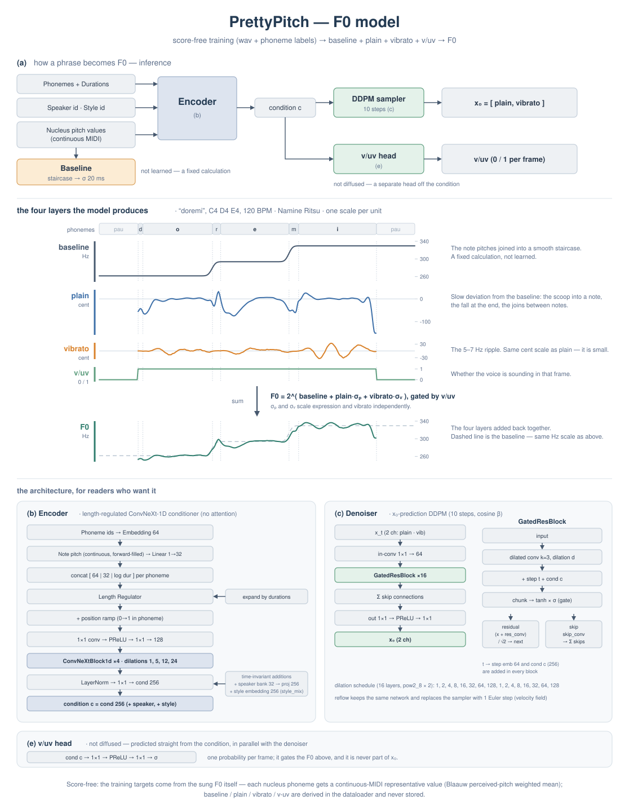
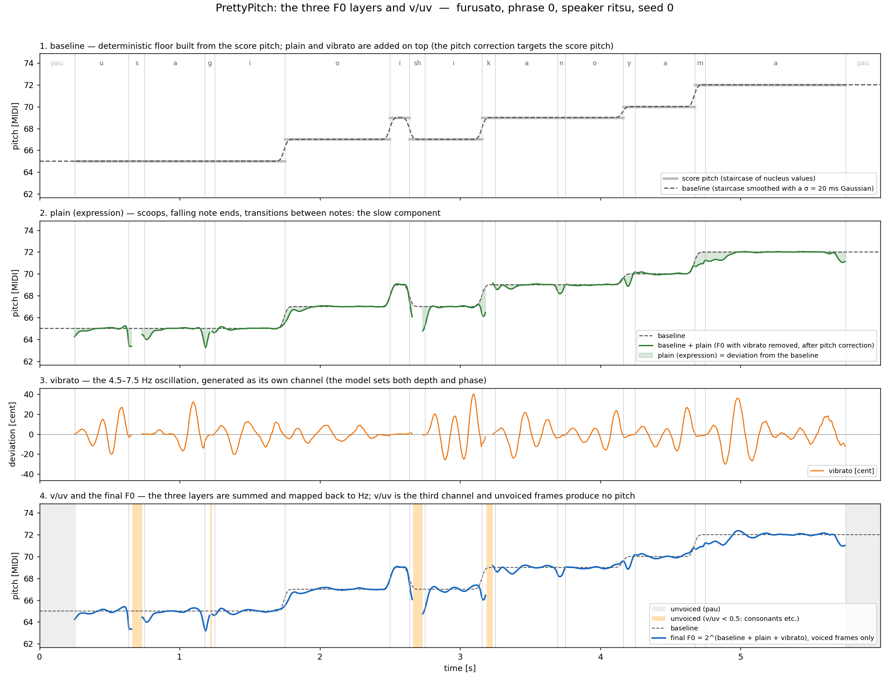

# F0 モデルの構成

楽譜と話者から F0 を作るモデルです。生成するのは 3 チャンネルで、F0 そのものではありません。



## 3 層の和

F0 は対数（log2）の領域で 3 つのレイヤーの和として扱います。

```
F0 = 2^(baseline + plain·σ_plain + vibrato·σ_vib)
```



| 層 | 誰が作るか | 中身 |
|---|---|---|
| baseline | 決まった式 | ノート音高（学習時は代表値）の階段状の値を σ = 20 ms で丸めたもの |
| plain（抑揚） | モデル | しゃくり、語尾の落ち、ノート間のつなぎ、ノート内の揺れ |
| vibrato | モデル | 4.5〜7.5 Hz の振動 |
| v/uv | モデル | フレームごとの有声確率。生成後に 0.5 で二値化 |

baseline はモデルが生成しません。学習でも推論でも同じ式で作る土台で、残りの層は「baseline からのずれ」として学習されます。音高が楽譜におおよそ沿うのは、この土台があるからです。

plain と vibrato の分け方は [vibrato_separation.md](vibrato_separation.md) に書いてあります。

## エンコーダ

attentionを使わない ConvNeXt-1D の列です。

1. 音素 id を 64 次元に埋め込み、ノート音高（連続値・前方補完）を 1 → 32 の線形層に通し、対数持続長と合わせて音素ごとにconcatします。
2. Length Regulatorが持続長ぶんだけ引き伸ばします。
3. 音素内の位置を表す 0 → 1 の直線を concat します。
4. 1×1 conv → PReLU → 1×1 で 128 次元にし、ConvNeXtBlock1d を 4 つ通します。dilation は 1, 5, 12, 24 です。
5. LayerNorm と 1×1 で 256 次元の条件 `c` にします。

これに時間方向に一定な項を足します。話者バンク（32 次元）を 256 次元へ射影したものと、スタイル埋め込み（256 次元）です。スタイルは `style_mix` で連続的に混ぜられ、one-hot を渡せば `style_id` と出力が完全に一致します。

**スタイルが F0 に与える差は小さいです。** 同梱ウェイトの 3 スタイル（リツの kire / normal / soft）で比べると、生成 F0 の差は中央値 3.5 セントで、聴き分けはできません。3 音源の違いは主に声色にあり、音高の振る舞いの差が小さいためです。学習データで測ると、ビブラートの大きさはほぼ同じで、抑揚の大きさだけが kire → normal → soft と 13〜17% 小さくなります。学習はされていて、評価句で正しいスタイルを与えると 3 つとも誤差が最小になります。

## デノイザ

x0 を直接予測する DDPM です。既定 10 ステップ、コサイン β スケジュールです。

- 入力は 2 チャンネル（plain と vibrato）のノイズ付き系列
- 1×1 conv で 64 次元にし、GatedResBlock を 16 個通します
- dilation は 1, 2, 4, …, 128 を 2 周します
- スキップ接続の和を 1×1 → PReLU → 1×1 に通して 2 チャンネルの x0 を出します

各ブロックにはステップ埋め込み（64 次元）と条件 `c`（256 次元）が入ります。

v/uv だけはデノイザーを使いません。条件 `c` から 1×1 → PReLU → 1×1 → σ で直接出します。

## サンプラーの選択

`model.arch` で切り替えます。

| arch | 既定ステップ数 | 備考 |
|---|---|---|
| `diffusion` | 10 | 既定。公開ウェイトはこちら。DDPM の x0 直接予測 |
| `reflow` | 1 | 同じネットワークのまま、速度場を 1 回のオイラー法で積分する |

ネットワークは同じで、サンプラーだけが違います。cent RMSE では reflow がわずかに良いのですが、聴いて判断し、DDPM を既定にしています。

## 生成時の調整

```python
out = infer.synthesize_f0(model, cfg, score, plain_scale=1.2, vib_scale=0.5)
```

`plain_scale` と `vib_scale` はスカラーでもフレームごとの配列でも渡せます。フレーズの中で時間変化させる例は `notebooks/03_f0_control.ipynb` にあります。

生成後には 2 段のピッチ補正が掛かります（[pitch_correction.md](pitch_correction.md)）。

## 学習時の教師データ

教師データはビブラート用の出力と抑揚用の出力のために別々に分けます。核音素ごとの代表値（[representative_pitch.md](representative_pitch.md)）で baseline を組み立て、残差を plain と vibrato に分け、その 2 チャンネルを拡散の目標にします。

どれもデータローダーが毎回計算するもので、前処理の shard には保存しません。分解のパラメータを変えたいときは config を書き換えるだけで、前処理をやり直す必要はありません。
