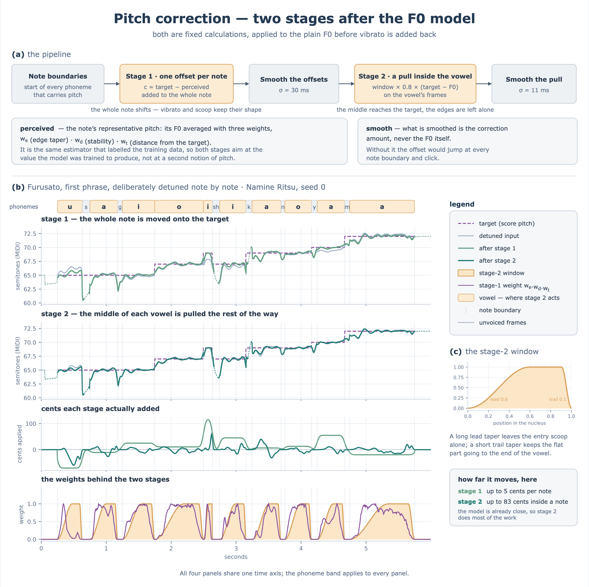

# Pitch correction at synthesis time

Two stages pull the output of the F0 model toward the intended pitch. Both are fixed calculations with no learning. The implementation is `prettypitch/correction.py`, and `infer.synthesize_f0()` calls it.



## What it aims at

The target is the note pitch from the score. The code estimates how high the generated F0 currently sounds, the perceived pitch, and closes the gap.

The perceived pitch is estimated much like the F0 representative value used in training ([representative_pitch.en.md](representative_pitch.en.md)). **The purpose differs, so there are several differences.**

The training label exists to copy the pitch that was actually sung. It demands accuracy where estimation is reliable, and tolerates some error elsewhere. The perceived pitch in correction cares most about not correcting toward an unintended F0. It takes the safer value.

| | Training label | Perceived pitch in correction |
|---|---|---|
| w_e | asymmetric 0.8 / 0.3 | symmetric Tukey α = 0.5 |
| w_d | first derivative of SG (the slope) | residual from SG |
| σ of w_t | 1.0 semitone | 0.5 semitone |
| the arch rule for short notes | yes | no |

## How note boundaries are decided

Stage 1 decides one correction amount per note. So it needs to know where the next note starts in the frame sequence.

It does not decide this from changes in the pitch value. Two notes at the same pitch in a row must still get one correction each. It uses the phoneme sequence instead. A boundary is the frame where any of these starts.

- A phoneme that carries a pitch value, that is, a nucleus phoneme
- A rest
- The start of a phrase

## Stage 1 — a constant offset per note

For each note span it finds one difference between the perceived pitch and the target, `c = target − perceived`, and adds that same value across the whole span. Rests get `c = 0`.

The value is constant inside a span, so vibrato and scoop keep their shape. The whole note simply shifts.

A Gaussian with σ = 30 ms smooths the joined `c` vector, so note boundaries connect smoothly.

## Stage 2 — shaping with a window

Over the frames of a nucleus phoneme, it applies a correction proportional to the actual per-frame gap.

```
correction = window × α × (target − F0)
```

α defaults to 0.8. The window is an asymmetric Tukey. It cosine-tapers over 0.6 at the head and 0.1 at the tail.

- **A long taper at the head** keeps the scoop at the entry. That is the expression of the singing onset, and we do not want to erase it.
- **A short taper at the tail** extends the flat part almost to the end. The correction then reaches the overshoot in the second half right up to the end.

`window='hann'` gives a window that peaks in the middle. It pulls only the middle and leaves both ends.

## The order of application

Both stages apply **to plain only**, before vibrato is added. Estimating the representative value on a signal with the oscillation mixed in throws the estimate off.

## How to turn it off

```python
out = infer.synthesize_f0(model, cfg, score, correction=False, hann_alpha=0.0)
```

`correction=False` stops stage 1. `hann_alpha=0.0` stops stage 2. Use them for an A/B comparison.

## Main defaults

What you can pass from `synthesize_f0()`.

| Argument | Default | Meaning |
|---|---|---|
| `hann_alpha` | 0.8 | Strength of stage 2. 0 disables it |
| `hann_window` | `tukey` | Window for stage 2. `hann` is also available |
| `hann_lead_taper` | 0.6 | Head taper of the stage 2 window, as a fraction of the vowel length |
| `hann_trail_taper` | 0.1 | Tail taper of the stage 2 window |

The stage 1 hyperparameters have no entry point in `synthesize_f0()` and are fixed. To change them, call `apply_pitch_correction()` directly.

| Argument | Default | Meaning |
|---|---|---|
| `sigma_st` | 0.5 | σ of w_t in stage 1 [semitones] |
| `smooth_sigma_ms` | 30.0 | Smoothing σ for the stage 1 correction amount |
