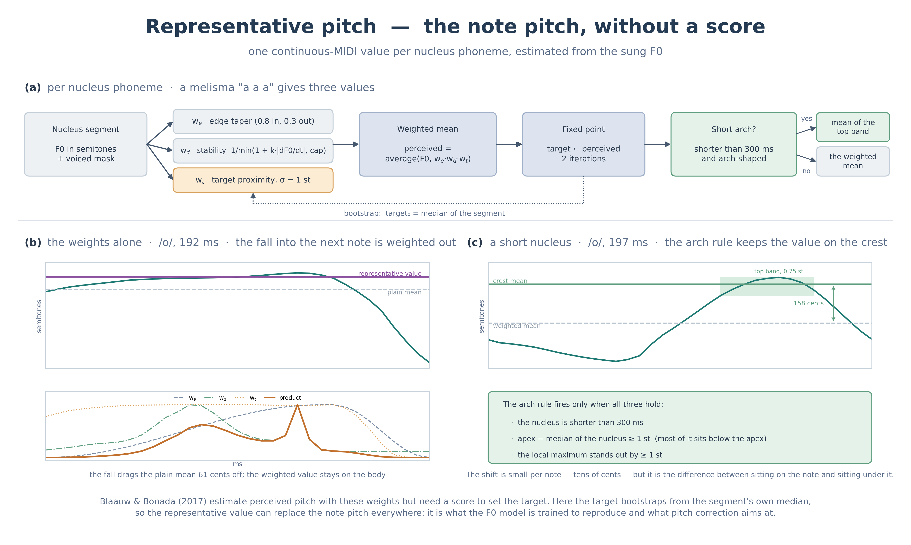

# Estimating the representative pitch

To train without a score, "what pitch is this note" is decided from the sung F0 itself. That number is the representative value: one continuous MIDI value per nucleus phoneme. A melisma sung as "a a a" gives three of them.

The implementation is `nucleus_values()` in `prettypitch/pitch.py`.

## What it is for

In score-based singing synthesis the note pitch is written in the input. Score-free, there is no such input, so the condition the model is given — what pitch to sing — has to be built from the audio.

This document describes the **training-side** representative value. It is the foundation the baseline staircase is built on, and the model learns deviations from that baseline.

The same family of weights is used by the pitch correction at synthesis time, but **with different settings**. The purposes differ; [pitch_correction.en.md](pitch_correction.en.md) has the comparison table.

## How the estimate works

It builds on the perceived-pitch estimate of Blaauw & Bonada (2017). Over the span of a nucleus phoneme, it takes a weighted mean of three weights multiplied together.

| Weight | Meaning | Effect |
|---|---|---|
| w_e | Edge taper, an asymmetric Tukey with 0.8 in and 0.3 out | Plays down the transitions to the neighbouring phonemes |
| w_d | Stability, 1 / min(1 + k·\|dF0/dt\|, cap) | Plays down the parts that are moving |
| w_t | Target proximity, exp(−(F0 − target)² / 2σ²) with σ = 1 semitone | Discards scoops and portamento as outliers |

w_t needs a target, and there is no score to supply one, so it starts from the median of the span and repeats `target ← weighted mean` twice. The median is robust to scoops, which makes it good enough as a starting point.

## w_d measures the slope

Another option is the residual from a Savitzky-Golay smooth, that is, how jagged a frame is (`stability='blaauw'`). A cubic fits a straight ramp almost exactly, so that measure does not react to one. The result is inverted: the middle of a scoop gets the heaviest weight.

By default the measure is the magnitude of the SG first derivative, in semitones per second. Flat stretches weigh most; sloped ones weigh less.

## Catching the arch on a short note

A short vowel after a consonant has a shape of its own: a deep valley, an arch, then a fall into the next note. Bootstrapping from the median throws the apex out as an outlier, and the representative value lands between the valley and the arch.

Only when all three of the following hold is the value replaced by the mean of the band near the apex, within 0.75 semitones of it.

- The nucleus phoneme is shorter than 300 ms. An arch on a long nucleus is vibrato or overshoot, so leave it alone.
- Apex minus the median inside the nucleus is at least 1 semitone. Most of the note sits below the apex, which is what makes it an arch.
- The local maximum has a prominence of at least 1 semitone.

The shift is tens of cents per note. It is the difference between sitting on the note and sitting under it.

## Devoiced vowels

Japanese devoiced vowels (A I U E O) sometimes have almost no voiced frames. By default (`devoiced_fill='interp'`) the estimate runs on the stored interpolated F0 as it is.

That makes a devoiced vowel a full citizen of the score. The model learns to generate an interpolated F0 that passes through it, and a user can write one in a score.

## Main constants

| Constant | Default | Meaning |
|---|---|---|
| `TARGET_SIGMA_ST` | 1.0 | The σ of w_t [semitones] |
| `SG_WINDOW_MS` | 55.0 | The Savitzky-Golay window |
| `SLOPE_K` / `SLOPE_CAP` | 0.5 / 15.0 | The slope coefficient and the floor of w_d |
| `CREST_MAX_MS` | 300.0 | The longest nucleus the arch rule will look at (0 disables it) |
| `CREST_BAND_ST` | 0.75 | How many semitones below the apex to average over |
| `N_ITER` | 2 | How many fixed-point iterations the target takes |
