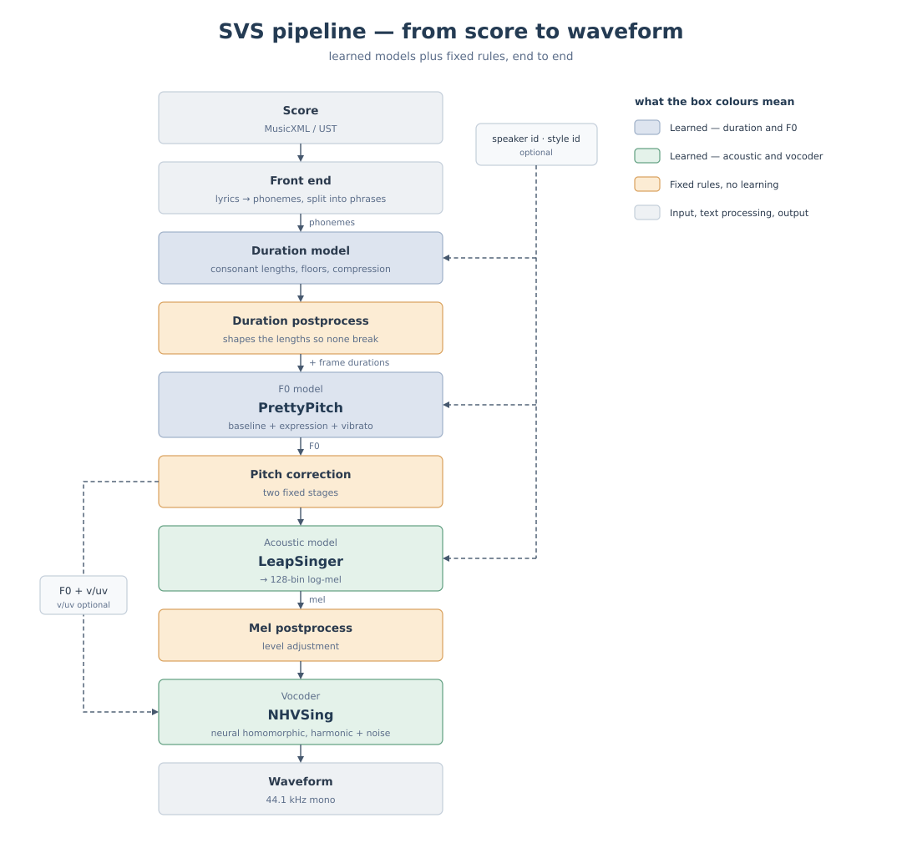

# How the SVS fits together

Between reading a score and returning a waveform, three trained models and several fixed procedures run in order.



## 1. Load the score

`svs/score_io.py` normalises MusicXML and UST into the same intermediate form. Lyrics become phoneme strings through the mora table that `dict/<lang>.yaml` names under `mora:`, and a rest of 0.5 s or longer cuts a phrase.

The phrase is the unit of synthesis. Each phrase is synthesised on its own, then placed back on the score's timeline.

### How much MusicXML is read

A file exported by notation software can be passed as it is. `.mxl` — the compressed format MuseScore saves by default, a zip inside — is unpacked here. In a score with an accompaniment, **one part is sung: the first one that has lyrics** (`--part` takes a part id or part-name to choose another). Ties are folded into a single note. Left unfolded, the phonemes are re-articulated part way through a sustain, and the extra note boundary reaches the pitch correction too.

Some things are not read. **Several voices within one part, `<backup>` / `<forward>`, repeat signs, a tempo change part way through, and a `divisions` that changes part way through** are unsupported. Rather than quietly sing something else, the loader prints a warning when it finds one. Expand the repeats before passing a score that has them.

### Phonemes instead of lyrics

A lyric becomes phonemes through the mora table that `dict/<lang>.yaml` names under `mora:`. In Japanese, writing か gives `k a`.

**Phonemes can also be written straight into the lyric field.** When it splits on whitespace into tokens that are all in the phoneme inventory, it is taken as a phoneme sequence.

| Lyric field | Phonemes |
|---|---|
| `か` | `k a` (through the mora table) |
| `ky o` | `ky o` (taken directly) |

English needs this. `mora` is `null` in `dict/en.yaml`, because English spelling cannot be mapped to phonemes by longest match (`shh` splits into `sh` + `h`). Write ARPAbet instead.

| Lyric field | Phonemes |
|---|---|
| `k l ow s` | `k l ow s` |
| `close` | Not read. It is not in the phoneme inventory, so the mora table is consulted and fails |

To write words instead, build a table limited to your vocabulary and pass it with `--mora_table` (one word per line, `close<TAB>k l ow s`). General English needs a G2P.

**The bundled weights cannot sing English, though.** The score is read, but the F0 model, the consonant-length model and the acoustic model were all trained on three Japanese singers, and English phonemes are not in their vocabulary (it stops with `phonemes not in the model vocab`). Singing English means training on English data — `configs/recipes/example_filled_en.yaml` is the place to start.

For reference, the 56 MusicXML files bundled with the Oniku Kurumi singing database — all written by MuseScore 3.4.2 — are read without a single warning. 348 of their 6931 notes carry a tie.

## 2. Decide the durations

The consonant-duration model predicts a length for each consonant, and the post-processing settles its share against the vowel. [duration_model.en.md](duration_model.en.md) has the details. What comes out here is a frame count, and every model after this point works on that frame grid.

## 3. Generate the F0

The F0 model produces baseline, plain, vibrato and v/uv, which combine into the F0. One layer has two names. The figure calls it expression; the code and the config keys call it `plain`. The architecture is in [f0_model.en.md](f0_model.en.md), the representative values used for training in [representative_pitch.en.md](representative_pitch.en.md), and the split between plain and vibrato in [vibrato_separation.en.md](vibrato_separation.en.md).

## 4. Correct the pitch

Two fixed correction stages act on `plain` ([pitch_correction.en.md](pitch_correction.en.md)). The target is the note pitch from the score. The correction estimates the perceived pitch of the generated F0 and closes the gap between the two.

## 5. Acoustic model and vocoder

From here on it is the LeapSinger acoustic model and the NHVSing vocoder. The acoustic model turns the phoneme string, the frame lengths and the F0 into a 128-bin log-mel, and the vocoder synthesises a waveform from the mel, the F0 and the voiced/unvoiced flag.

The acoustic model does not take v/uv as a condition, but the vocoder does. It uses the flag to shut off the harmonic excitation on unvoiced frames and leave only the noise component.

## 6. Setting the level

**Two adjustments are made to the mel before it reaches the vocoder.** This is the only place anything touches the mel.

**Loudness matching.** A constant is added to the mel so that the size of its voiced frames meets a target. The vocoder was trained on data normalised to an active RMS of 0.111, and it is at its best when driven at that level. Raising the level on the waveform instead raises the vocoder's own noise along with the signal. Measured without this step, the waveform had to be amplified by up to 2.3 times.

**A frame limiter.** Any frame that is still too loud is brought down on its own. The bundled vocoder clips its output to the range −1 to 1 right at the end, so a loud mel gets crushed there. In practice it fires on fewer than 0.1 per cent of frames and sits there as a guard.

**Nothing touches the waveform.** The level is already settled on the mel, so the waveform that comes out is left as it is. Measured across songs and speakers, it spans 1.55 dB and peaks between 0.32 and 0.68. `--normalize peak` restores the old behaviour of scaling the loudest sample to 0.95, if you want it.

## Which parts are machine-learned and which are rule-based

| Learned | Fixed procedure | Not needed at all |
|---|---|---|
| Consonant lengths, F0, mel | Phrase placement, consonant floors and compression, pitch correction, level setting | Note onsets, note pitches, a reference score |

A score is read only at inference. Training needs nothing but singing wav files and phoneme labels. The pitch target is built from the sung F0 itself. That is what score-free means here.

## Speakers and styles

The speaker id goes to all three models: the consonant-duration model, the F0 model and the acoustic model. Consonant lengths change with the speaker, so the same score comes out at a slightly different total length for each voice.

Ranges differ between speakers. When a score does not fit, move it in semitones with `--transpose`.

## Synthesis

```python
from svs.render import render_score
wav, sr = render_score("examples/kirakiraboshi.musicxml", spk_id=2)
```

To load the models once and synthesise many times, build an `SvsContext` with `load_models()` and pass it as `render_score(..., ctx=ctx)`. When you do, `spk_id` and `lang` are **silently ignored**. The speaker is fixed the moment you call `load_models(spk_id=...)`, so build a new `SvsContext` to change it. When you want the intermediate results of one phrase, `render_phrase()` returns the durations, the F0, the mel and the waveform.
