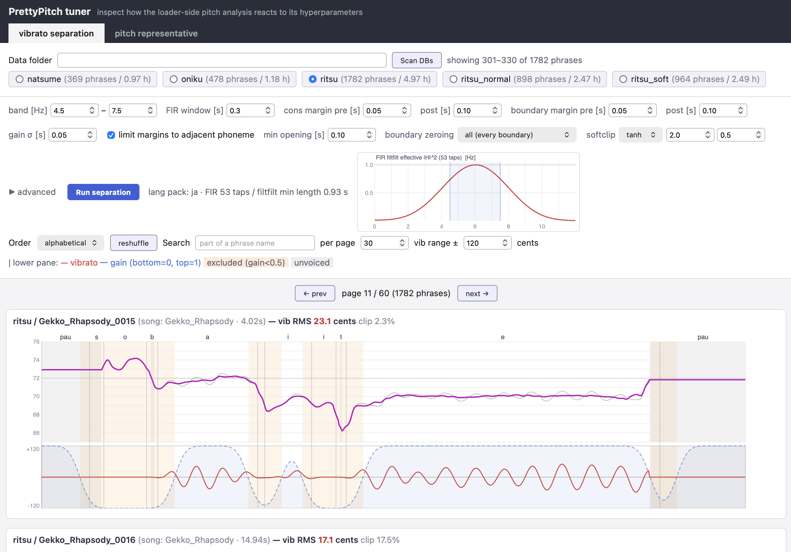
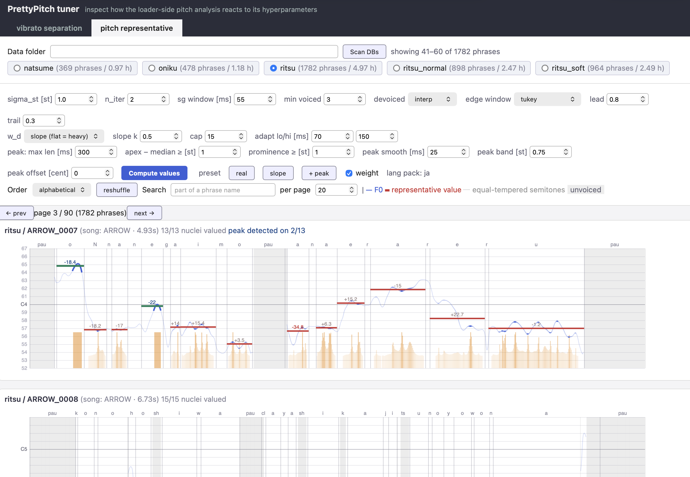

# チューナー — 学習時のハイパーパラメータを目で確かめる

ビブラート抽出と F0 代表値推定のハイパーパラメータを調整するウェブアプリです。どちらも**学習時にデータローダーが毎回計算する**もので、前処理では決まりません。フレーズごとに並び、値を変えるとその場で描き直します。

```bash
pip install -e ".[tuner]"
python vibrato_separation_tuner/app.py        # http://127.0.0.1:8017
```

`--port 8017` でポート番号を変えられます。前処理済みのデータセット（`data/<db>/shard.npz` と `metadata.json`）を読むので、先に `preprocess.run` を通しておいてください。

**描いているのは学習時と全く同じ計算結果です。** 内部で `prettypitch.decomp` と `prettypitch.pitch` をそのまま呼んでいるので、ここで見えたものがモデルの教師データになります。

タブが 2 つあります。

## ビブラート分離



残差を plain と vibrato に分けるハイパーパラメータの効果を可視化できます（[vibrato_separation.md](vibrato_separation.md)）。

上段が F0 と plain の重ね描き、下段が vibrato とゲイン曲線です。ゲインが 0 の区間には橙の帯が付くので、子音の周りと音素境界がどれだけ除外されているかが一目で分かります。

| 設定 | 何が変わるか |
|---|---|
| band [Hz] | ビブラートとみなす周波数帯。既定 4.5–7.5 |
| FIR window [s] | フィルタの長さ。右上に実効特性と最小フレーズ長が出る |
| cons / boundary margin | 子音の周りと音素境界をゼロにする幅（前・後で別々） |
| gain σ [s] | ゲイン曲線の平滑 |
| softclip | しゃくりが偽ビブラートになるのを抑える閾値と強さ |

`vib RMS` がフレーズごとの振幅、`clip` がソフトクリップの掛かった割合です。値を決めたら `configs/ja_example.yaml` の `decomp:` に書き写します。DB ごとに変えるなら `decomp.per_db` です。

## 代表値



核音素ごとの代表値をどう決めるかを見ます（[representative_pitch.md](representative_pitch.md)）。

F0 の曲線に、各核音素の代表値が横線で重なります。線の上の数字は平均律からのずれ（セント）で、山検出が発火した核は緑になります。橙の縦棒は重みです。どのフレームが値を決めたかが読めます。

| 設定 | 何が変わるか |
|---|---|
| sigma_st | w_t の σ。小さいほどしゃくりを強く捨てる |
| w_d | どこを「動いている」とみなすか。`slope`（既定）は F0 の傾きの大きさ、`blaauw` は平滑曲線からのずれ（ギザギザさ） |
| edge window / lead / trail | 端のテーパーの形。非対称にもできる |
| peak: max len / apex−median / prominence | 短いノートの山検出が発火する条件 |
| peak band / offset | 山の頂点付近をどれだけ平均するか |

`preset` のボタンで 3 つの設定を切り替えられます。`real` はギザギザさで測る素の設定、`slope` は傾きで測る設定、`+ peak` はそれに短いノートの山検出を足したものです。

**`+ peak` が配布ウェイトの学習設定です。** `configs/ja_example.yaml` の `pitch:` と同じ値になります。

## 共通の操作

- **Data folder** には起動時に `data/` が入っています。別の場所を見るときだけ書き換えます。空にすると起動したディレクトリを見にいくので、消さないでください。
- **Scan DBs** で一覧を作り直します。並ぶのは `shard.npz` と `metadata.json` の両方があるディレクトリだけです。選べるのは一度に 1 つです。
- **Order** で `alphabetical` と `shuffled` を切り替えます。**reshuffle** は別のボタンで、押すと並びを振り直します。特定のフレーズを探すときは **Search** に名前の一部を入れます。
- 値を変えたら **Run separation** / **Compute values** を押すと描き直します。

前処理をやり直す必要はありません。shard には生の音素・F0・uv しか入っておらず、分解も代表値も毎回ここで計算しているためです。
