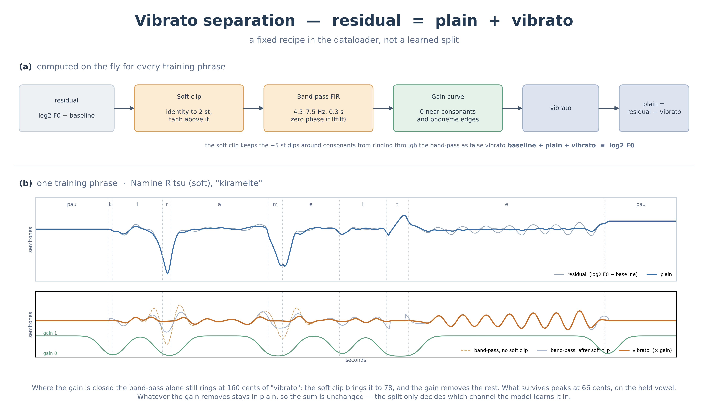

# ビブラートの分離

F0 の残差を plain と vibrato の 2 つのチャンネルに分けます。データローダーが毎回計算する決まった手順です。分け方をモデルが学ぶわけではありません。実装は `prettypitch/decomp.py` です。



## なぜ分けるか

ビブラートと抑揚は時間スケールも制御したい単位も違います。一緒に学習すると、ビブラートを強くするつもりで抑揚まで動いてしまいます。

分けておくと、生成時に `plain_scale` と `vib_scale` で別々に強さを変えられます。フレーム別の配列を渡せば、フレーズの途中で変えることもできます（`notebooks/03_f0_control.ipynb`）。

## 手順

残差は `residual = log2(F0) − baseline` です。

1. **ソフトクリップ** (`compress_residual`) 2 半音までは何もせず、超えた分だけ tanh で飽和させます。母音冒頭のしゃくりは −5 半音級の急変で、これがビブラート帯にエネルギーを持ち、フィルタがリンギングして偽のビブラートを作ります。振幅側から先に抑えます。実際のビブラート（±2 半音以内）は無傷です。

2. **帯域通過** (`extract_vibrato`) 4.5〜7.5 Hz の FIR を `filtfilt` で零位相に掛けます。FIR はタップ数ではなく「秒」で設計します（0.3 秒）。帯域は物理量なのでフレームレートに依りません。

3. **ゲイン** (`make_vibrato_gain`) 核でも `pau` でもない区間とその周り、音素境界の周りを 0 にした 0/1 カーブを、σ = 0.05 秒のガウシアンで平滑して 0〜1 のゲインにします。周りを 0 にする幅は前後で別々に決められ、配布設定では前 0.05 秒・後ろ 0.1 秒です。子音の直後はしゃくりの立ち上がり、境界の直後は次の母音の頭で、どちらもビブラートではない音程遷移が乗ります。

4. **差し引き** `vibrato = ゲイン × 帯域通過出力`、`plain = residual − vibrato`。

## 再構成は必ず保たれる

ゲインが落とした分は plain が吸収するので、

```
baseline + plain + vibrato ≡ log2(F0)
```

は常に成り立ちます。分離が下手でも F0 は壊れません。決めているのは「どちらのチャンネルでモデルに学ばせるか」だけです。

## 短いフレーズ

`filtfilt` には最小系列長（3 × タップ数 + 1）があります。0.3 秒の FIR・172.27 fps なら 53 タップなので、0.93 秒より短いフレーズはビブラートが全部ゼロになります（その分は plain に残ります）。

データセットの `min_sec` はこの制約から決めています。既定は 1.7 秒で、下限の 0.93 秒に対して安全側の余裕を取った値です。

## 主な定数

| 定数 | 既定 | 意味 |
|---|---|---|
| `VIB_BAND_HZ` | (4.5, 7.5) | ビブラート帯 [Hz] |
| `FIR_TIME_LEN_SEC` | 0.3 | FIR の長さ [秒] |
| `VIB_COMP_THRESH_ST` | 2.0 | ソフトクリップが恒等でいる範囲 [半音] |
| `GAIN_MARGIN_SEC` | 0.10 | 子音区間・音素境界の前後をゼロにする幅 |
| `GAIN_SIGMA_SEC` | 0.05 | ゲイン曲線の平滑 σ |

学習と推論では `configs/<recipe>.yaml` の `decomp:` にある値が使われます。モジュールの既定値は `configs/ja_example.yaml` と同じに揃えてあります。
